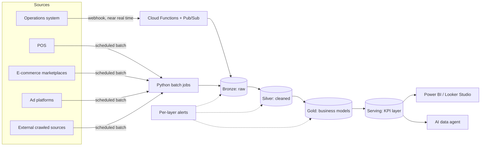

# Omnichannel Retail Data Platform on BigQuery

> Architecture write-up of a production data platform I designed, built and operated end to end for a multichannel retail company. **This repository contains documentation only — no source code, schemas or company data.**

## Problem

A multichannel retail business had its data scattered across an operations system, POS, e-commerce marketplaces, ad platforms and external sources. Reports were built by hand, numbers disagreed between systems, and department heads waited for answers they needed the same day.

## Solution

A BigQuery-based platform using a **Medallion architecture** (Bronze → Silver → Gold → Serving) that unifies all sources, checks quality at every layer, controls who can see what, and feeds dashboards and an AI data agent from one Serving layer.

## Key design decisions

- **Two ingestion modes.** Near-real-time webhooks for the core operational system, where freshness matters; scheduled batch for every other source, where it does not. This keeps cost and complexity proportional to need.
- **Layered quality.** Alerts are defined per layer, so a problem is caught where it starts rather than in a dashboard.
- **Role-based data access.** Data permissions follow business roles, so staff see what they need and nothing more.
- **Reconciliation against source systems.** Revenue, inventory and order counts (per employee and per sales channel) are checked against the reports of the original systems, which is what makes the numbers trusted.
- **A Serving layer designed around KPIs.** Dashboards read from one curated layer instead of each building its own logic.

## Cost optimisation

BigQuery cost was reduced by cutting bytes scanned:

- partitioning and clustering tables
- incremental loads instead of full reloads
- SQL tuning
- scheduling heavy jobs deliberately

## Outcome

- Operational dashboards for staff up to heads of sales departments, replacing manual reports and supporting same-day decisions
- One governed source of truth shared by BI and an AI data agent
- Data processes standardised across departments

## Tech stack

BigQuery SQL · Python · dbt · Cloud Functions · Pub/Sub · Cloud Storage · n8n · Power BI · Looker Studio

## My role

Owned the data architecture; wrote SQL and Python, reviewed, tested and deployed to production; coordinated Tech, System and AI teams on integrations; worked directly with leadership and department heads.

## Related

- [AI Data Agent for business self-service](../ai-data-agent-bigquery-mcp)
- [Haravan ↔ Pancake POS integration gateway](../haravan-pancake-pos-gateway)
